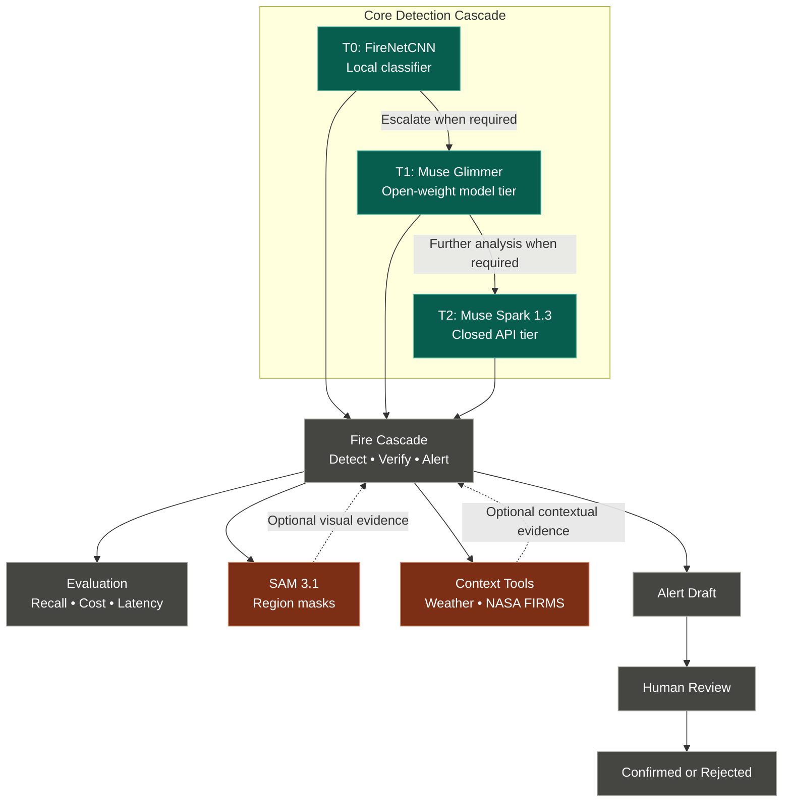
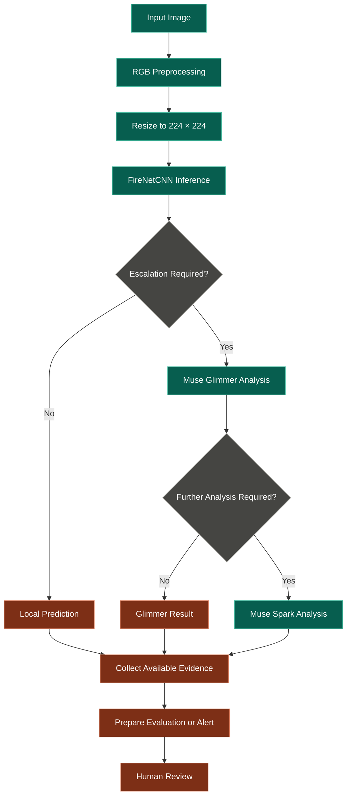

# 🔥 FireNet Cascade

### Tiered Wildfire & Smoke Detection with Vision AI

**FireNet Cascade** is a local-first wildfire and smoke detection system that combines a lightweight CNN classifier with progressively more capable vision-language models (VLMs). Its goal is to detect fire and smoke efficiently, escalate uncertain predictions for further analysis, and support evidence-based, human-reviewed alerts.

The project combines local inference, configurable AI escalation, statistical evaluation, and optional contextual evidence to explore the trade-offs between detection quality, inference latency, and API cost.

<p align="center">

<strong>Local Detection → AI Verification → Evidence → Human Review</strong>

</p>

---

## 📑 Table of Contents

* [🎯 Overview](#-overview)
* [✨ Key Features](#-key-features)
* [🏗️ System Architecture](#️-system-architecture)
* [🔄 Detection Workflow](#-detection-workflow)
* [📊 Current Results](#-current-results)
* [🧠 Model Cascade](#-model-cascade)
* [🛠️ Technology Stack](#️-technology-stack)
* [⚙️ Installation](#️-installation)
* [🚀 Run the Project](#-run-the-project)
* [🔬 Evaluation Methodology](#-evaluation-methodology)
* [🧪 Testing](#-testing)
* [🛡️ Error Handling and Safety](#️-error-handling-and-safety)
* [⚠️ Limitations](#️-limitations)
* [🗺️ Development Roadmap](#️-development-roadmap)
* [📚 Third-Party Attributions](#-third-party-attributions)

---

## 🎯 Overview

Wildfire detection systems must balance several competing requirements:

* **Accuracy:** Distinguish fire, smoke, and normal scenes.
* **Latency:** Process images quickly enough to support timely detection.
* **Cost:** Avoid unnecessary calls to expensive external models.
* **Reliability:** Handle missing weights, invalid images, and API failures.
* **Explainability:** Provide evidence that helps a human evaluate an alert.

FireNet Cascade explores a tiered approach to these challenges.

A local FireNetCNN classifier processes RGB images at a resolution of `224 × 224`. When a prediction meets the configured escalation criteria, the system can request additional analysis from vision-language models.

The local classifier provides the current measured baseline. The performance of the complete cascade remains to be established through live evaluation of the configured VLM services.

### 🎯 Classification Categories

| Class        | Description                                                          |
| ------------ | -------------------------------------------------------------------- |
| 🔥 `fire`    | Fire detected in the image                                           |
| 🌫️ `smoke`  | Smoke detected in the image                                          |
| 🌲 `no_fire` | Neither fire nor smoke according to the classifier's output category |

> **Important:** This is an experimental detection system, not a certified wildfire early-warning or emergency-response service. Model predictions require appropriate validation before operational use.

---

## ✨ Key Features

<details open>
<summary><strong>🔥 Local Fire and Smoke Classification</strong></summary>

* Uses the pretrained FireNetCNN model.
* Processes RGB images at `224 × 224`.
* Normalizes image values using division by `255`.
* Runs local inference without requiring a VLM API call for every image.
* Supports evaluation on the existing 405-image test split.

</details>

<details>
<summary><strong>🧠 Tiered Vision-Language Model Escalation</strong></summary>

The cascade is designed to use multiple analysis tiers:

1. **FireNetCNN:** Local image classification.
2. **Muse Glimmer:** Open-weight model tier, accessed through an appropriate serving provider.
3. **Muse Spark 1.3:** Closed-model API tier for further analysis.

The escalation process is intended to balance local inference efficiency against the additional capabilities and costs of remote models.

Live VLM comparison results are pending configuration and execution with valid credentials.

</details>

<details>
<summary><strong>📊 Statistical Evaluation</strong></summary>

The evaluation workflow includes:

* Classification metrics by category.
* Confidence-threshold analysis.
* Smoke recall monitoring.
* Bootstrap confidence intervals.
* Median and tail-latency measurements.
* Comparison of detection quality against inference cost.

The existing local-only evaluation provides the baseline against which future strategies can be compared.

</details>

<details>
<summary><strong>🛰️ Optional Contextual Evidence</strong></summary>

The architecture allows for optional contextual tools, including:

* **NASA FIRMS:** Satellite-based fire information.
* **Open-Meteo:** Weather information.
* **SAM 3.1:** Image-region masks that may help identify relevant visual evidence.

These are add-on capabilities, not prerequisites for the reported local-only baseline. Their integration and contribution to detection performance must be verified separately.

</details>

<details>
<summary><strong>👤 Human-Reviewed Alerts</strong></summary>

The proposed alert workflow produces an alert draft for human review.

A human should verify the available evidence before confirming an alert. Model predictions alone should not automatically be treated as confirmation of a real wildfire.

</details>

---

## 🏗️ System Architecture

The following diagram represents the intended tiered architecture, including the local classifier, model escalation, evidence collection, evaluation, and human-reviewed alert workflow.



### Architecture Components

| Component      | Responsibility                                                               |
| -------------- | ---------------------------------------------------------------------------- |
| FireNetCNN     | Provides the initial local classification                                    |
| Muse Glimmer   | Provides an additional analysis tier through an appropriate serving provider |
| Muse Spark 1.3 | Provides a further analysis tier through a configured API                    |
| Fire Cascade   | Coordinates detection, verification, and alert preparation                   |
| SAM 3.1        | Intended to provide region-level visual masks                                |
| Context tools  | Supply optional weather and satellite-fire information                       |
| Evaluation     | Measures recall, latency, and cost                                           |
| Alert draft    | Prepares information for human review                                        |
| Human reviewer | Evaluates the evidence and confirms or rejects the alert                     |

**Implementation note:** The diagram describes the intended system architecture. Optional integrations and live VLM execution must be verified against the implementation before being considered operational.

---

## 🔄 Detection Workflow



### Workflow Explanation

1. **Image input:** The system receives an image for analysis.
2. **Preprocessing:** The image is converted to RGB, resized to `224 × 224`, and normalized.
3. **Local inference:** FireNetCNN produces scores for the supported classes.
4. **Escalation:** If the configured escalation criteria are met, the image can be sent to Muse Glimmer.
5. **Further analysis:** Muse Spark can provide another analysis tier when required and configured.
6. **Evidence collection:** Optional image-region or environmental context may be incorporated where implemented.
7. **Evaluation and alert preparation:** The system records or prepares the available results.
8. **Human review:** A reviewer assesses the evidence before confirming an alert.

The exact escalation thresholds and response-handling rules should be taken from the implementation rather than inferred from the diagram.

---

## 📊 Current Results

The current reported baseline comes from `results/summary.md`, produced by `scripts/evaluate.py`.

### Local-Only Baseline

| Metric                        |      Result |
| ----------------------------- | ----------: |
| Evaluation split              |      `test` |
| Test images                   |         405 |
| Accuracy                      |   **85.4%** |
| 95% confidence interval       | 82.2%–88.9% |
| Median latency (p50)          |      246 ms |
| 95th-percentile latency (p95) |      742 ms |

These figures describe the **local-only classifier**, not the complete VLM cascade.

### Classification Performance

| Class      | Precision | Recall | F1-score |
| ---------- | --------: | -----: | -------: |
| 🌫️ Smoke  |     0.824 |  0.783 |    0.803 |
| 🔥 Fire    |     0.904 |  0.851 |    0.877 |
| 🌲 No fire |     0.844 |  0.925 |    0.882 |

### How to Interpret the Results

**Accuracy: 85.4%**

The classifier correctly predicts approximately 85.4% of the evaluated test images.

**Smoke recall: 78.3%**

The classifier identifies approximately 78.3% of the actual smoke examples in the evaluation set. This is an important metric because missed smoke detections can be consequential in a wildfire-monitoring context.

**Fire recall: 85.1%**

The classifier identifies approximately 85.1% of the actual fire examples in the evaluation set.

**Latency: 246 ms median**

The median reported inference latency is 246 milliseconds. The 95th-percentile latency of 742 milliseconds indicates that slower inferences take substantially longer than the median.

These latency figures are specific to the recorded evaluation environment and should not be assumed to represent performance on other hardware.

### Comparison with Previously Reported Results

| Class   | Previous precision | Previous recall | Current precision | Current recall |
| ------- | -----------------: | --------------: | ----------------: | -------------: |
| Smoke   |               0.84 |            0.67 |             0.824 |          0.783 |
| Fire    |               0.92 |            0.81 |             0.904 |          0.851 |
| No fire |               0.76 |            0.98 |             0.844 |          0.925 |

The current accuracy is slightly above the previously reported accuracy of 0.82.

However, the current smoke precision is slightly lower than the previous 0.84 figure, while smoke recall is higher than the previously reported 0.67. Fire precision and no-fire recall are lower than their previous reported values.

These comparisons should be interpreted cautiously unless the previous and current results were obtained using identical datasets, splits, preprocessing, and evaluation procedures.

<details>
<summary><strong>📐 Confidence intervals and evaluation caveats</strong></summary>

The reported 95% confidence interval for accuracy is 82.2%–88.9%.

Confidence intervals help characterize uncertainty in an estimated performance metric. They do not establish that a model will generalize to new geographic locations, weather conditions, camera types, or real-world wildfire scenarios.

The test set contains only 405 images. Small performance differences should therefore be interpreted cautiously, particularly when comparing models on the same limited dataset.

</details>

### VLM Evaluation Status

| Strategy                               | Status                                          |
| -------------------------------------- | ----------------------------------------------- |
| FireNetCNN local-only                  | Baseline results reported                       |
| Muse Glimmer only                      | Live evaluation pending                         |
| Muse Spark only                        | Live evaluation pending                         |
| Full cascade                           | Live evaluation pending                         |
| Cascade with optional contextual tools | Integration and evaluation pending verification |

The VLM client is designed to reject placeholder model labels rather than fabricate evaluation results.

---

## 🧠 Model Cascade

### T0 — FireNetCNN

**Role:** Local image classification.

* Input: RGB image.
* Input resolution: `224 × 224`.
* Preprocessing: Pixel values divided by `255`.
* Output classes: `fire`, `no_fire`, and `smoke`.
* Weights: `FirenetCNN1.h5`.

The verified output order is:

```text
[fire, no_fire, smoke]
```

The model's output ordering must be preserved when converting its predictions into class labels.

### T1 — Muse Glimmer

**Role:** Open-weight VLM analysis tier.

The project is designed to access Glimmer through a serving provider such as Modal or Fireworks.

Glimmer is not treated as a model available through the standard Meta API endpoint. Its serving configuration and availability depend on the chosen provider.

### T2 — Muse Spark 1.3

**Role:** Further analysis through a closed-model API.

The intended configuration uses `muse-spark-1.3`.

API availability, access permissions, model identifiers, pricing, and request limits must be verified against the provider's current documentation and account configuration.

### Optional Evidence Tools

| Tool       | Intended role                           |
| ---------- | --------------------------------------- |
| SAM 3.1    | Produce image-region masks              |
| NASA FIRMS | Supply satellite-based fire information |
| Open-Meteo | Supply weather information              |

These tools provide potential supporting evidence. Their availability does not guarantee that a suspected fire can be confirmed.

---

## 🛠️ Technology Stack

The repository's documented dependencies include:

| Technology      | Purpose                                                 |
| --------------- | ------------------------------------------------------- |
| Python          | Application and evaluation scripts                      |
| TensorFlow 2.20 | Deep learning framework                                 |
| Keras 3.12      | Model loading and inference                             |
| Pillow          | Image processing                                        |
| Gradio          | Interactive demonstration interface                     |
| httpx           | HTTP communication with external services               |
| Modal           | Potential serving infrastructure for open-weight models |
| Fireworks       | Potential VLM serving provider                          |

Optional integrations include Meta's model API, NASA FIRMS, and Open-Meteo, depending on the selected features.

Versions and integrations should be checked against the repository's actual dependency and configuration files before installation.

---

## ⚙️ Installation

The following commands are intended for **Windows with a CPU-only local inference environment**.

### 1. Clone the Repository

```powershell
git clone <YOUR_REPOSITORY_URL>
cd <YOUR_PROJECT_DIRECTORY>
```

Replace the placeholders with the actual repository URL and directory name.

### 2. Create a Virtual Environment

```powershell
python -m venv .venv
```

Activate it:

```powershell
.\.venv\Scripts\Activate.ps1
```

If PowerShell activation is unavailable, the environment's Python and pip executables can be invoked directly.

### 3. Install Dependencies

```powershell
.\.venv\Scripts\python.exe -m pip install -r requirements.txt
```

Use a Python version compatible with the dependencies specified by the project.

### 4. Configure Environment Variables

Create the local environment file:

```powershell
Copy-Item .env.example .env
```

Edit `.env` to supply the credentials and configuration needed for the integrations you intend to use.

<details>
<summary><strong>🔐 Configuration checklist</strong></summary>

The project documentation identifies the following configuration names:

| Variable            | Purpose                                                |
| ------------------- | ------------------------------------------------------ |
| `META_API_KEY`      | Authentication for the configured Meta API integration |
| `META_API_BASE`     | Base URL for the relevant API                          |
| `SPARK_MODEL`       | Spark model identifier                                 |
| `GLIMMER_MODEL`     | Glimmer model identifier                               |
| `GLIMMER_BASE_URL`  | Base URL for the Glimmer serving provider              |
| `SAM_MODEL`         | SAM model identifier                                   |
| `MODAL_*`           | Provider-specific Modal configuration, where required  |
| `FIREWORKS_API_KEY` | Authentication for Fireworks, if used                  |

The exact required variables, defaults, and accepted values depend on the implementation and selected providers. Check `.env.example` and the configuration-loading code before deciding which values are mandatory.

**Security:** Never commit `.env` or API credentials to source control. Use `.env.example` for safe configuration templates.

</details>

### 5. Prepare the Model Weights and Dataset

Run the project's setup script:

```powershell
.\.venv\Scripts\python.exe scripts/setup.py
```

The existing setup instructions specify that model weights are fetched into the Git-ignored `external/` directory.

To use a different local weights file, set `FIRENET_WEIGHTS` to the appropriate path if supported by the implementation.

The documented test dataset layout is:

```text
data/
└── forestfire-classifier-dataset/
    └── test/
        ├── fire/
        ├── nofire/
        └── smoke/
```

The evaluation script maps `nofire` to the `no_fire` class.

Ensure the dataset is available in the expected location before running evaluation.

---

## 🚀 Run the Project

### Evaluate the Local Classifier

The main reproducibility command is:

```powershell
.\.venv\Scripts\python.exe scripts/evaluate.py --split test
```

This runs the evaluation on the test split.

### Run the Test Suite

```powershell
.\.venv\Scripts\python.exe -m pytest -v
```

This invokes the project's pytest test suite.

### Launch the Demo

```powershell
.\.venv\Scripts\python.exe -m app.demo
```

This launches the Gradio demonstration entry point, provided the relevant dependencies and configuration are available.

### Quick Command Reference

| Task                    | Command                                   |
| ----------------------- | ----------------------------------------- |
| Prepare setup           | `python scripts/setup.py`                 |
| Run tests               | `python -m pytest -v`                     |
| Evaluate the test split | `python scripts/evaluate.py --split test` |
| Launch the demo         | `python -m app.demo`                      |

The examples in the table assume that the virtual environment is active. The full Windows commands above invoke the environment's Python executable directly.

---

## 🔬 Evaluation Methodology

FireNet Cascade uses a consistent evaluation methodology to make comparisons meaningful.

### Evaluation Principles

1. **Consistent test data:** Compare strategies on the same test set.
2. **Threshold analysis:** Investigate local classifier confidence thresholds.
3. **Recall monitoring:** Pay particular attention to smoke recall.
4. **Confidence intervals:** Use bootstrap estimates to characterize uncertainty.
5. **Latency analysis:** Report median and tail latency.
6. **Cost awareness:** Evaluate the implications of remote model calls.
7. **Honest reporting:** Distinguish measured results from pending experiments.

### VLM Client Design

The documented VLM client uses an OpenAI-compatible request format:

```text
POST {base}/chat/completions
```

The described client behavior includes:

* Base64-encoded image input.
* A configured temperature of `0.1`.
* JSON-object response formatting.
* Retries with backoff.
* A concurrency limit.
* Disk caching based on model, image hash, and prompt.
* A configurable budget guard with a documented $20 limit.

The exact enforcement behavior and applicability of these safeguards should be confirmed in the implementation and configuration.

The budget limit should not be interpreted as a guarantee of provider-side spending unless the relevant controls enforce it.

### Reproducibility

To reproduce the local baseline, run:

```powershell
.\.venv\Scripts\python.exe scripts/evaluate.py --split test
```

For meaningful comparisons, preserve the same test data, preprocessing, model weights, and evaluation configuration.

Record the execution environment and relevant configuration when comparing results across machines or model providers.

---

## 🧪 Testing

The project documents pytest as its automated test framework.

Run:

```powershell
python -m pytest -v
```

Run the evaluation separately:

```powershell
python scripts/evaluate.py --split test
```

These commands serve different purposes:

| Check                | Purpose                                                |
| -------------------- | ------------------------------------------------------ |
| Automated tests      | Check implemented behavior and expected conditions     |
| Local evaluation     | Measure classifier performance on the selected dataset |
| VLM experiments      | Compare configured remote-model strategies             |
| Latency measurements | Assess inference performance                           |
| Cost analysis        | Assess the financial impact of remote inference        |

Passing automated tests does not, by itself, establish that the detector is reliable in real-world wildfire conditions.

No new test execution or results are claimed by this README.

---

## 🛡️ Error Handling and Safety

The documented design includes several safeguards.

<details>
<summary><strong>Missing or corrupted model weights</strong></summary>

Missing weights or invalid model files should produce a clear error rather than silently initiating a retraining process.

</details>

<details>
<summary><strong>Invalid images</strong></summary>

Image-loading and preprocessing failures should be reported explicitly. Invalid inputs should not silently produce a valid-looking detection result.

</details>

<details>
<summary><strong>Unconfigured VLM services</strong></summary>

When a VLM is not configured, the client should refuse to generate a fabricated model label or pretend that a remote analysis occurred.

</details>

<details>
<summary><strong>Malformed model responses</strong></summary>

The documented client design retries parsing or request failures and can abstain when a usable result cannot be obtained.

</details>

<details>
<summary><strong>API budget protection</strong></summary>

A budget guard is documented to prevent the application from continuing to spend beyond its configured limit. Its actual enforcement should be verified against the implementation and provider billing behavior.

</details>

### Operational Safety

* Treat predictions as model-generated assessments, not verified emergency reports.
* Require human review before confirming an alert.
* Do not interpret the absence of a detection as proof that no wildfire exists.
* Validate performance on diverse conditions before considering operational deployment.
* Keep API keys and other credentials private.

---

## ⚠️ Limitations

| Limitation                                                 | Implication                                                         |
| ---------------------------------------------------------- | ------------------------------------------------------------------- |
| Test set contains 405 images                               | Estimates may not generalize to unseen environments                 |
| Dataset provenance needs a precise source reference        | Independent reproduction and auditing are more difficult            |
| Live VLM evaluation is pending                             | The complete cascade's accuracy and cost are not yet established    |
| Remote VLM outputs may vary                                | Repeated requests may not always produce identical responses        |
| Local inference is CPU-based in the reported baseline      | Latency may be higher than on supported accelerated hardware        |
| Optional contextual integrations require verification      | Their availability and contribution to performance remain uncertain |
| Historical results may use different evaluation conditions | Direct performance comparisons may be misleading                    |

### Important Research Limitation

The local classifier's measured accuracy should not be presented as the accuracy of the complete tiered system.

A cascade must be evaluated end to end to determine whether escalation actually improves detection performance enough to justify its additional latency and cost.

---

## 🗺️ Development Roadmap

The following roadmap identifies possible next steps. These are proposals, not claims that the functionality is already implemented.

* [ ] Complete reproducible Muse Glimmer evaluation.
* [ ] Complete reproducible Muse Spark evaluation.
* [ ] Measure end-to-end cascade performance.
* [ ] Compare recall, latency, and cost across all strategies.
* [ ] Document the exact dataset source and provenance.
* [ ] Evaluate false positives and false negatives separately.
* [ ] Verify SAM 3.1 integration and its contribution to visual evidence.
* [ ] Validate contextual integrations using NASA FIRMS and weather data.
* [ ] Improve the human-review workflow.
* [ ] Test robustness under different lighting, visibility, and environmental conditions.
* [ ] Document deployment requirements and operational safeguards.

---

## 📚 Third-Party Attributions

This project documents the use of the following libraries and services:

* TensorFlow
* Keras
* Pillow
* Gradio
* httpx
* Modal
* Fireworks
* Meta model API
* NASA FIRMS
* Open-Meteo

The applicability of optional services depends on the selected project configuration.

### Previous Work

The earlier repository, [Forest-Fire-Detection-Using-FirenetCNN-and-XAI-Techniques](https://github.com/OpelSpeedster/Forest-Fire-Detection-Using-FirenetCNN-and-XAI-Techniques), contributed the trained model weights:

`FirenetCNN1.h5`

The current repository is described as a fresh implementation, with new application code and the previously trained weights reused for inference.

Please consult the upstream repository and relevant model or dataset licenses before redistributing the weights or datasets.

---

## 📌 Project Status

| Component                            | Current status                                |
| ------------------------------------ | --------------------------------------------- |
| Local FireNetCNN baseline            | Evaluated; results documented                 |
| Model preprocessing and output order | Verified according to project notes           |
| Automated test suite                 | Available; execution status not asserted here |
| Muse Glimmer comparison              | Pending live evaluation                       |
| Muse Spark comparison                | Pending live evaluation                       |
| Complete cascade comparison          | Pending live evaluation                       |
| Optional contextual evidence         | Integration status requires verification      |
| Human-reviewed alert workflow        | Included in the intended architecture         |

**Research objective:** Develop and evaluate a tiered wildfire detection approach that balances local inference efficiency, detection quality, additional evidence, and the cost of remote AI analysis.

---

<p align="center">

<strong>🔥 FireNet Cascade — Detect locally. Escalate thoughtfully. Review responsibly.</strong>

</p>
